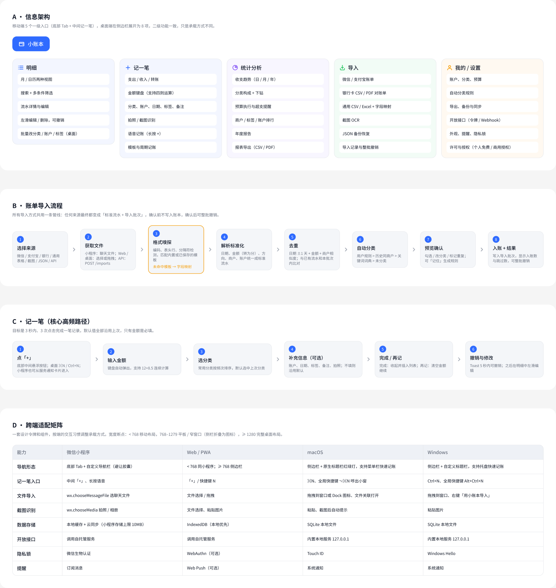
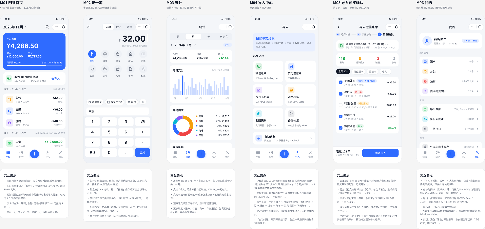
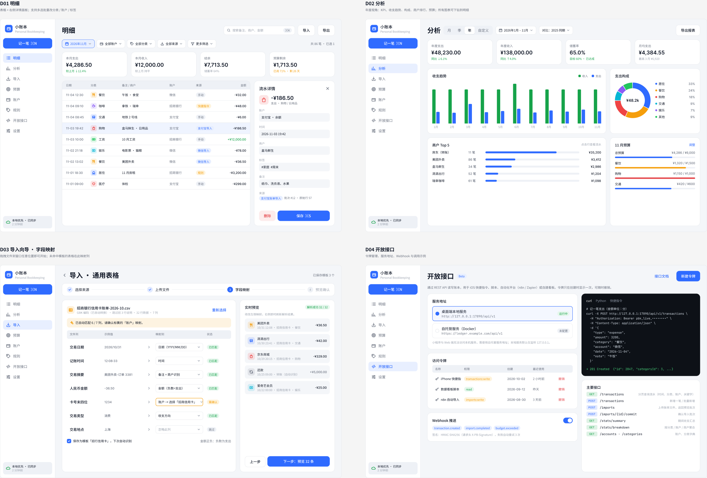
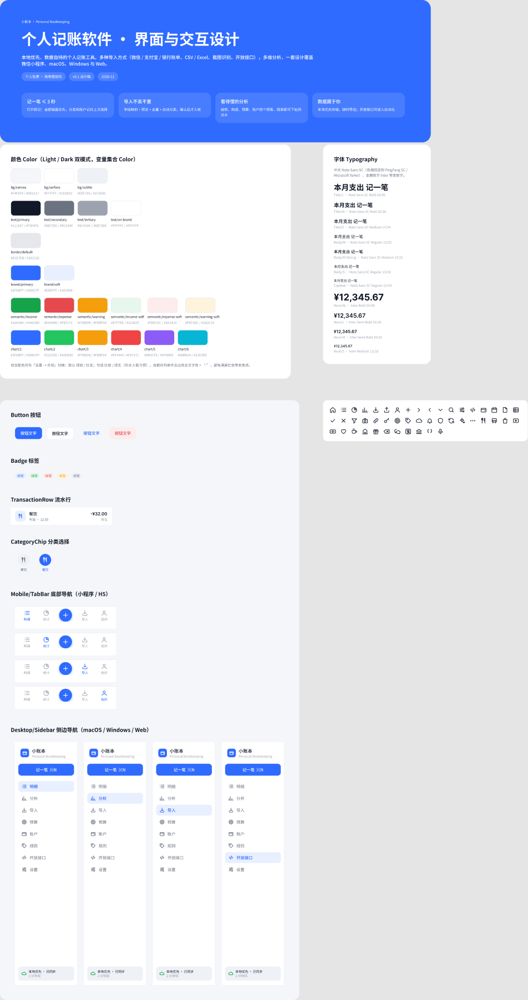

# 界面与交互设计 v0.1

> 状态：设计稿初版（2026-11）。视觉稿以 Figma 为准，本文档记录信息架构、核心流程、交互规则和跨端适配约定，供实现时对照。
>
> Figma 文件：[Personal Bookkeeping · 界面与交互设计](https://www.figma.com/design/etyiqe2b7JcEPnH81mDHk9)

| Figma 页面 | 内容 |
| --- | --- |
| `00 设计规范 Foundations` | 封面与设计原则、颜色变量（Light / Dark）、字体样式、组件、图标 |
| `01 移动端（小程序 / H5）` | M01–M06 共 6 屏，每屏下方附「交互要点」 |
| `02 桌面端（macOS / Windows / Web）` | D01–D04 共 4 屏 |
| `03 信息架构与交互流程` | 信息架构、导入流程、记一笔流程、跨端适配矩阵 |

## 1. 产品定位与设计原则

小账本（Personal Bookkeeping）是一个**本地优先、数据自持**的个人记账工具：多种账单导入方式、多维分析、开放接口，一套设计覆盖微信小程序、macOS、Windows 与 Web。个人使用免费，商用需授权（授权条款见仓库 LICENSE，由授权相关工作单独维护）。

设计原则：

1. **记一笔 ≤ 3 秒**：打开即聚焦金额，分类、账户沿用上次，只有金额必填。
2. **导入不丢不重**：所有来源走同一条管线，先预览、去重、补分类，用户确认后才入账，且可整批撤销。
3. **看得懂的分析**：趋势、构成、预算、排行四个视角，所有图表都能下钻到对应流水。
4. **数据属于你**：默认只存本地，随时导出；开放接口让用户把数据接入自己的自动化。

## 2. 信息架构

| 一级入口 | 二级功能 |
| --- | --- |
| 明细 | 月 / 日历视图；搜索与多条件筛选；流水详情与编辑；左滑编辑 / 删除（可撤销）；批量改分类 / 账户 / 标签（桌面） |
| 记一笔 | 支出 / 收入 / 转账；金额键盘（支持四则运算）；分类、账户、日期、标签、备注；拍照 / 截图识别；语音记账；模板与周期记账 |
| 统计分析 | 收支趋势；分类构成与下钻；预算执行；商户 / 标签 / 账户排行；年度报告；报表导出 |
| 导入 | 微信 / 支付宝账单；银行卡 CSV / PDF；通用 CSV / Excel + 字段映射；截图 OCR；JSON 备份恢复；导入记录与整批撤销 |
| 我的 / 设置 | 账户、分类、预算；自动分类规则；导出、备份与同步；开放接口；外观、提醒、隐私锁；许可与授权 |

导航承载：

- **移动端**（小程序、窄屏 Web）：底部 Tab「明细 / 统计 / ＋ / 导入 / 我的」，中间悬浮按钮进入记一笔。
- **桌面端**（macOS、Windows、宽屏 Web）：左侧边栏「明细 / 分析 / 导入 / 预算 / 账户 / 规则 / 开放接口 / 设置」，顶部固定「记一笔」按钮，底部显示同步状态。

## 3. 界面清单

### 3.1 移动端

| 编号 | 界面 | 关键交互 |
| --- | --- | --- |
| M01 | 明细首页 | 顶部月份选择，横滑切月；汇总卡显示本月支出 / 收入 / 结余与预算进度（> 80% 橙、> 100% 红）；检测到账单文件时出现导入提示；流水按日分组，左滑编辑 / 删除，删除后 Toast 5 秒内可撤销；长按「＋」语音记账 |
| M02 | 记一笔 | 半屏弹层，进入即弹数字键盘；分类宫格按使用频次排序；底部字段条（账户、时间、标签、拍照）不填则沿用默认；「再记」保存后清空金额继续；转账模式下分类区换成「转出 → 转入账户」并可填手续费 |
| M03 | 统计 | 周 / 月 / 年 / 自定义；支出 / 收入 / 结余口径切换；KPI 与上一期对比；点柱子或扇区底部弹出对应流水；超支预算置顶标红 |
| M04 | 导入中心 | 6 类来源卡片 + 自动记账入口；每个来源有导出教程；导入记录可整批撤销 |
| M05 | 导入预览确认 | 三步条（选择文件 → 字段映射 → 预览确认）；新增 / 疑似重复 / 待分类 / 忽略 汇总；疑似重复默认不勾选；待分类行点选分类可「记住」为规则 |
| M06 | 我的 | 账本管理、数据、通用三组设置；「许可与授权」展示个人免费 / 商用授权并可输入授权码 |

### 3.2 桌面端

| 编号 | 界面 | 关键交互 |
| --- | --- | --- |
| D01 | 明细 | 工具栏（搜索 ⌘K、导入、导出）+ 筛选条（时间、账户、分类、来源、更多）；KPI 条；表格（日期、分类、备注 / 商户、账户、来源、金额）；选中行在右侧详情面板编辑，⌘S 保存；多选后批量修改 |
| D02 | 分析 | 月 / 季 / 年 / 自定义 + 同比对比；KPI；收支趋势分组柱状图；支出构成环形图；商户 Top 5；预算执行。所有图表点击下钻到 D01 并带上筛选条件 |
| D03 | 导入向导 · 字段映射 | 四步条；文件信息（编码、跳过行数、行列数）；逐列映射（文件列 → 示例值 → 目标字段 → 状态），需确认项标黄；可保存为模板；右侧实时预览解析结果 |
| D04 | 开放接口 | 服务地址（桌面本地服务 / 自托管服务）；访问令牌列表（名称、权限、创建、最近使用、撤销）；Webhook 开关与事件；调用示例（curl / Python / 快捷指令）；主要接口列表 |

## 4. 核心流程

### 4.1 记一笔

1. 点「＋」（桌面 ⌘N / Ctrl+N，全局快捷键呼出小窗）。
2. 输入金额，键盘支持 `12+8.5` 连续计算。
3. 选分类，默认选中上次使用的分类。
4. （可选）账户、日期、标签、备注、拍照。
5. 「完成」收起弹层并把新记录插入列表；「再记」只清空金额。
6. 保存后 5 秒内可撤销，之后在明细中左滑编辑。

校验规则：金额必须大于 0，最多两位小数，存储时转为「分」的整数（与现有 `src/lib/money.ts` 一致）；未来日期允许但给出提示。

### 4.2 账单导入管线

所有来源统一为「标准流水 + 导入批次」，确认前不写入账本：

1. **选择来源**：微信 / 支付宝 / 银行卡 / 通用表格 / 截图 / JSON 备份 / API。
2. **获取文件**：小程序用 `wx.chooseMessageFile` 从聊天记录选文件；Web 与桌面端选择或拖拽（桌面端支持拖到窗口任意位置、Dock 图标或右键菜单）；API 走 `POST /imports`。
3. **格式嗅探**：检测编码（UTF-8 / GBK）、表头所在行、分隔符，匹配内置模板或用户保存的模板；未命中则进入字段映射。
4. **解析标准化**：日期、金额（转为分）、收支方向、商户、账户统一成标准流水。
5. **去重**：日期 ±1 天、金额相同、商户相似度达到阈值视为疑似重复；同时比对已有流水和本批次内部。
6. **自动分类**：优先级为 用户规则 > 历史同商户 > 内置关键词词典 > 未分类。
7. **预览确认**：可勾选、改分类、标记重复；改分类时勾选「记住」生成规则。
8. **入账与结果**：写入导入批次，显示入账数与跳过数；导入记录中可整批撤销该批次。

特殊处理：微信零钱 / 支付宝余额宝等内部互转识别为「转账」，不计入收支；信用卡还款识别为转账；退款与原交易关联并冲减。

### 4.3 导入来源

| 来源 | 格式 | 获取方式 | 识别要点 |
| --- | --- | --- | --- |
| 微信账单 | xlsx / csv | 微信 → 我 → 服务 → 钱包 → 账单 → 下载账单，发送到邮箱或聊天 | 跳过说明行；「收/支」列为「/」的是中性交易（零钱互转等） |
| 支付宝账单 | csv（GBK） | 支付宝 → 我的 → 账单 → 开具交易流水证明 | 「收/支」「交易状态」过滤关闭 / 退款 |
| 银行卡账单 | csv / PDF 对账单 | 网银或 App 导出 | 各行内置模板；PDF 先抽表格再走通用映射 |
| 通用表格 | csv / xlsx | 任意 | 字段映射 + 可保存模板 |
| 截图识别 | 图片 | 拍照、相册、粘贴 | OCR 识别金额、商户、时间后回填记一笔，或批量进入预览 |
| JSON 备份 | json | 本应用导出 | 原样恢复，按 ID 合并 |
| 开放接口 | JSON | `POST /transactions`、`POST /imports` | 快捷指令、脚本、自动化平台 |

### 4.4 分析下钻

任意图表元素（柱子、扇区、排行行、预算行）点击后：移动端底部弹出流水列表，桌面端跳转 D01 并带上对应筛选条件（时间段 + 分类 / 商户 / 账户），筛选条以高亮标签显示，可一键清除。

## 5. 开放接口（交互层面）

接口的服务端实现和部署方式由部署相关工作确定，这里只约定用户可见的交互和接口形态草案：

- **服务地址**：桌面端内置本地服务（默认只监听 `127.0.0.1`）；小程序和 Web 无法访问本机，需使用自托管服务地址。
- **访问令牌**：用户自建，命名 + 选择权限（`read`、`transactions:write`、`imports:write`）；令牌只在创建时显示一次，可随时撤销，列表显示最近使用时间。
- **Webhook**：事件 `transaction.created`、`import.completed`、`budget.exceeded`；请求头 `X-PB-Signature` 带 HMAC-SHA256 签名，失败重试 3 次。
- **接口草案**（前缀 `/api/v1`，金额单位为分）：

| 方法 | 路径 | 说明 |
| --- | --- | --- |
| GET | `/transactions` | 分页查询（时间、分类、账户、关键字） |
| POST | `/transactions` | 新增一笔或批量新增 |
| POST | `/imports` | 上传账单文件，返回预览批次 |
| POST | `/imports/{id}/commit` | 确认导入批次 |
| GET | `/stats/summary` | 期间收支汇总 |
| GET | `/stats/breakdown` | 按分类 / 账户 / 商户聚合 |
| GET | `/accounts`、`/categories` | 字典数据 |

## 6. 跨端适配

宽度断点：`< 768` 移动布局；`768–1279` 平板 / 窄窗口（侧边栏折叠为 72px 图标栏）；`≥ 1280` 完整桌面布局。

| 能力 | 微信小程序 | Web / PWA | macOS | Windows |
| --- | --- | --- | --- | --- |
| 导航 | 底部 Tab + 自定义导航栏（避让右上胶囊） | `< 768` 同小程序，`≥ 768` 侧边栏 | 侧边栏 + 原生标题栏，菜单栏快速记账 | 侧边栏 + 自定义标题栏，托盘快速记账 |
| 记一笔入口 | 中间「＋」，长按语音 | 「＋」/ 快捷键 N | ⌘N，全局 ⌥⌘N 小窗 | Ctrl+N，全局 Alt+Ctrl+N |
| 文件导入 | `wx.chooseMessageFile` | 文件选择 / 拖拽 | 拖拽、Dock、文件关联 | 拖拽、右键菜单 |
| 截图识别 | `wx.chooseMedia` | 文件选择、粘贴 | 粘贴、截图后提示 | 粘贴 |
| 数据存储 | 本地缓存 + 云同步（本地存储上限 10MB） | IndexedDB | SQLite 本地文件 | SQLite 本地文件 |
| 开放接口 | 调用自托管服务 | 调用自托管服务 | 内置本地服务 | 内置本地服务 |
| 隐私锁 | 微信生物认证 | WebAuthn（可选） | Touch ID | Windows Hello |
| 提醒 | 订阅消息 | Web Push（可选） | 系统通知 | 系统通知 |

小程序注意事项：自定义导航栏需用 `wx.getMenuButtonBoundingClientRect` 计算胶囊位置；底部预留 34px 安全区；tabBar 用自定义组件实现中间悬浮按钮。

## 7. 设计规范

- **颜色**：Figma 变量集合 `Color`，Light / Dark 两种模式，分 `bg/*`、`text/*`、`border/*`、`brand/*`、`semantic/*`、`chart/1–6`。实现时映射为 CSS 变量，深色模式跟随系统或手动切换。
- **收支配色**：默认「绿收红支」，设置中可切换为「红收绿支」。列表中支出金额使用主文字色加「-」，收入用 `semantic/income` 加「+」，避免满屏红色。
- **字体**：中文 Noto Sans SC（各端回退 PingFang SC / Microsoft YaHei），金额数字 Inter（等宽数字 `font-variant-numeric: tabular-nums`）。样式见 Figma 文本样式 `Title/*`、`Body/*`、`Caption`、`Num/*`。
- **间距与圆角**：变量集合 `Space & Radius`，间距 4 的倍数；圆角 8 / 12 / 16 / 24。
- **组件**：`Button`（Primary / Secondary / Ghost / Danger）、`Badge`（Brand / Income / Expense / Warning / Neutral）、`TransactionRow`、`CategoryChip`、`Mobile/TabBar`、`Desktop/Sidebar`，以及 47 个 24px 线性图标。
- **无障碍**：触控目标不小于 44×44；正文与背景对比度不低于 4.5:1；桌面端所有操作可用键盘完成（表格方向键移动、Enter 编辑、Esc 关闭面板）；图表提供数据表视图供读屏使用。

## 8. 对现有代码的影响（建议）

现有 `src/types.ts` 的 `Transaction` / `Category` / `Account` 可以覆盖 M01–M03 的基础功能。要支持导入、规则和分析，建议后续逐步扩展：

- `Transaction` 增加 `merchant?`、`tags?: string[]`、`source: 'manual' | 'import' | 'api' | 'rule'`、`importBatchId?`、`transferAccountId?`（转账）。
- 新增 `ImportBatch`（来源、文件名、模板、行数、入账数、创建时间、状态）用于导入记录与整批撤销。
- 新增 `CategoryRule`（匹配字段、匹配方式、关键词、目标分类、优先级）。
- 新增 `Budget`（周期、分类可选、金额）。
- 新增 `ImportTemplate`（列映射、编码、跳过行数、日期格式）。

## 9. 待定问题

1. 云同步方案（WebDAV / 自建服务 / 官方云）与小程序数据的关系，取决于部署方案。
2. 截图 OCR 用端侧还是云端，涉及隐私说明与成本。
3. 多账本（家庭账本、共享账本）是否在 v1 范围内；当前设计按单账本处理。
4. 商用授权码的校验方式（离线签名或在线校验）。
